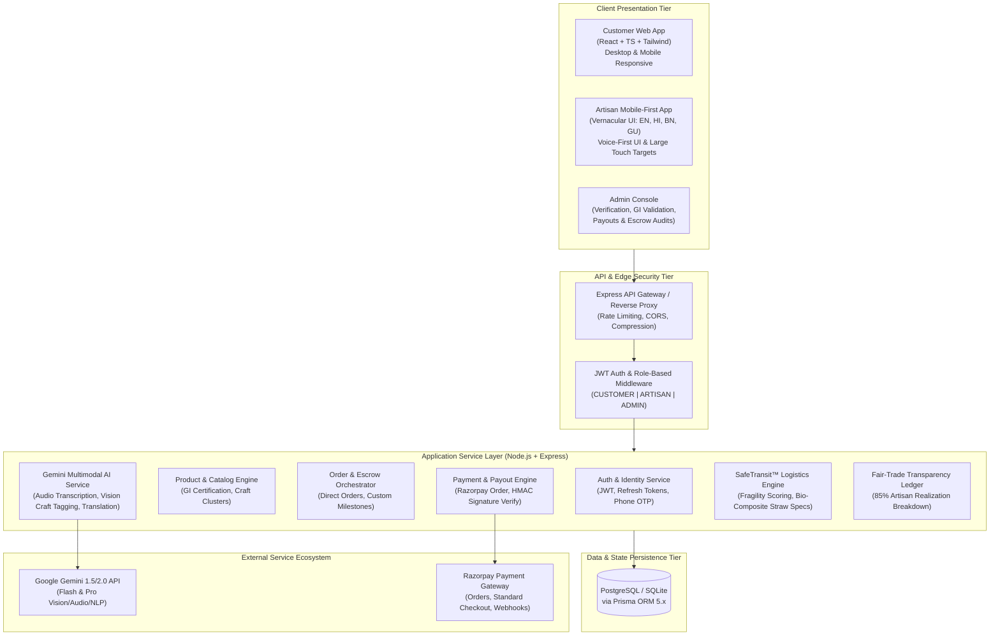

# KalaSetu (कला सेतु) — Indian Artisan E-Commerce Marketplace

> **Direct-to-Connoisseur Fair-Trade Marketplace Connecting Bharat's Master Clay & Ceramic Lineages with Urban Patrons, Eliminating Middlemen and Ensuring Zero-Breakage Logistics.**

[](https://nodejs.org/)
[](https://react.dev/)
[](https://www.typescriptlang.org/)
[](https://tailwindcss.com/)
[](https://www.prisma.io/)
[](https://ai.google.dev/)
[](https://razorpay.com/)
[](https://opensource.org/licenses/MIT)

---

## 🌟 Executive Summary & Problem Solved

Traditional Indian clay, pottery, and terracotta craft lineages suffer from severe outreach and logistical bottlenecks documented in our fieldwork survey (*Indian Clay & Ceramic Artisan Survey*):

1. **Catastrophic Transit Breakage**: Bengal terracotta and earthenware experience **20%–35% transit breakage** (Table 4 reports 27.5%), draining **₹280 of every ₹1,000 retail value**.
2. **Poverty Realization**: Exploitative middlemen markups leave generational master potters earning as little as **₹13.10 per family-hour**.
3. **Digital Illiteracy**: Traditional craft elders cannot type complex English product listings or navigate standard e-commerce platforms.
4. **Contract Default & Mold Theft**: Sculptors suffer from buyer defaults and piracy of master sculpting molds.

**KalaSetu directly eliminates these bottlenecks:**
- **SafeTransit™ Bio-Composite Packaging**: Drop-tested moulded paddy straw shock inserts reduce transit breakage from 27.5% to **under 3%**, backed by a **100% Free Replacement Mutual Reserve Pool** at zero cost to the artisan.
- **85% Direct Artisan Realization**: Every product displays the exact amount disbursed directly to the artisan lineage, lifting family realization from **₹13.10/hr to ₹68.60/hr (+423%)**.
- **Gemini Multimodal Voice Intake**: Artisans simply snap a photo and hold a microphone to describe their craft in **Bengali, Hindi, or Gujarati**; Gemini AI transcribes, translates, and generates structured catalog data.
- **3-Stage Milestone Escrow**: Advance for clay/armature (25%), prototype photo review (35%), and crated dispatch (40%), with SHA-256 digital copyright timestamps.

---

## 👥 The 7 Surveyed Artisan Clusters

| Artisan / Lineage | Cluster Location | Craft Discipline | Materials / Mineral Base | Key Problem Solved | KalaSetu Intervention |
|---|---|---|---|---|---|
| **Dipankar Kundu & Pal Lineage** | Bishnupur, Bankura, West Bengal | Heritage Bengal Terracotta | Local alluvial clay, sand, wood smoke | 27.5% transit breakage; ₹13.10/hr return; digital illiteracy | Bio-composite straw shock-rated inserts (&lt;3% breakage); Vernacular AI voice onboarding |
| **Nand Kishore** | Jaipur, Rajasthan | Jaipur Blue Pottery (**GI-Tagged**) | Quartz 80%, cullet glass, soda, katira | 3-month monsoon solar-drying freeze (₹12-15L idle loss); REBA 8 strain | Monsoon advance buffer; wholesale B2B portal; SafeTransit cell dividers |
| **Priya Jethwa** | Kutch, Gujarat | Traditional Lippan Kaam (Mud-Relief) | Alluvial mud, straw, chalk, mirror Aabhla | Carpentry outsourcing drains ₹333/₹1000 base; transit micro-cracks | In-house woodworking kit savings; Rigid pine corner protectors |
| **Deepak Prajapati** | Nizamabad, Azamgarh, Uttar Pradesh | GI Smoked Black Earthenware with Silver Inlay | Riverbed clay + Kabiz slip (mango bark/ash) + silver inlay | Smoke respiratory hazard; unmonitored firing temp; 12% hairline cracks | GI badge certification; clean reduction saggars; SafeTransit cushioning |
| **Shibu Biswas** | Krishnanagar, Nadia, West Bengal | Hyper-Realistic Miniature Figurines | Fine Ganga alluvial silt, cotton lint, wire | Annual price lock vs 15-25% inflation; 400% gallery markup | Connoisseur direct auction & custom contracts; inflation-pegged pricing |
| **Santu Roy** | Kumartuli, Kolkata, West Bengal | Monumental Fine Arts & Sculptures (Up to 22-ft) | POP, fiberglass resin, bronze, steel armature | Rampant IP/mold theft; buyer contract defaults | 3-stage milestone escrow; digital IP timestamping; crated safe dispatch |
| **Nayanben** | Ahmedabad, Gujarat | Premium Wall Mirror Decor | MDF + Synthetic Clay + Mirrors | RULA 6 wrist/shoulder pain; manual kneading | Ergonomic 30° easel; mechanical clay roller; direct domestic decor market |

---

## 🏗️ System Architecture



---

## 🛠️ Technology Stack

- **Frontend**: React 18, TypeScript, Tailwind CSS, Lucide Icons, Vite
- **Backend**: Node.js, Express, RESTful APIs, Zod validation
- **Database & ORM**: PostgreSQL / SQLite, Prisma ORM 5.x
- **Authentication**: JWT (Access + Refresh tokens), Passwordless Phone/SMS Vernacular OTP
- **AI Multimodal**: Google Gemini API (Multilingual speech transcription, vision craft analysis, translation into English, Bengali, Hindi, Gujarati)
- **Payments**: Razorpay Standard Checkout with cryptographic HMAC-SHA256 server signature verification
- **Logistics**: SafeTransit™ Volumetric & Fragility Engine (Moulded bio-composite paddy straw shock inserts)

---

## 🚀 Quick Start Guide

### Prerequisites
- Node.js 18+ or 20+
- Git

### 1. Clone the Repository
```bash
git clone https://github.com/Aaratrika-Bhattacharya/kalasetu-artisan-marketplace.git
cd kalasetu-artisan-marketplace
```

### 2. Backend Setup
```bash
cd backend
npm install

# Initialize Prisma schema and seed database with the 7 master lineages
npx prisma db push
node src/seed.js

# Run automated integration tests (21 tests)
node src/testIntegration.js

# Start backend server (port 5000)
npm start
```

### 3. Frontend Setup
In a new terminal:
```bash
cd frontend
npm install

# Build production bundle or run dev server
npm run build
npm run dev
```

Open **`http://localhost:5000`** (or `http://localhost:3000` in dev mode) in your browser.

---

## 🧪 Automated Integration Tests

KalaSetu includes an end-to-end integration test suite verifying 21 critical milestones:
```bash
cd backend
node src/testIntegration.js
```

**Test Coverage:**
- [x] API Health & Diagnostics
- [x] Craft Clusters & GI Metadata
- [x] Product Catalog & 85% Fair-Trade Allocation
- [x] Gemini Multimodal Voice Onboarding & Bengali/Hindi/Gujarati/English Translation
- [x] Vernacular Artisan OTP Generation & JWT Authentication
- [x] Customer Registration & Login
- [x] Cart Checkout with Volumetric SafeTransit Shipping
- [x] Razorpay Order Creation
- [x] **Strict Rejection of Tampered/Fake Signatures (Anti-Fraud)**
- [x] Cryptographic HMAC-SHA256 Signature Verification & Order Paid Capture
- [x] SafeTransit™ Live Tracking & Bio-Straw Packaging Specifications
- [x] Admin Governance Analytics & Transit Breakage Metrics
- [x] Bespoke Custom Commission with 3-Stage Milestone Escrow & SHA-256 Mold Copyright

---

## 📜 License

This project is licensed under the MIT License - see the [LICENSE](LICENSE) file for details.

---

*Preserving Bharat's Generational Craft Lineages with Dignity, Technology & Fair Realization.*
